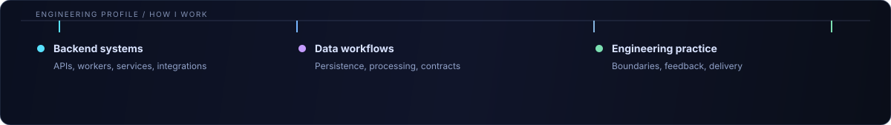

  

 

## Profile

I am a backend developer focused on **C#/.NET and Python**. I build APIs, integrations, background workers, and data services for products that need clear boundaries, reliable execution, and useful observability.

  

<b>FOCUS</b> &nbsp; Backend architecture · API design · Async processing · Data pipelines · Automation

## Professional experience

Work experience across backend platforms, search, analytics, AI-assisted workflows, and production operations.

<table>
  <tr>
    <td width="50%" valign="top">
      <strong>BACKEND & INTEGRATIONS</strong>
        
      <code>C#</code> <code>.NET</code> <code>REST API</code> <code>DI</code> <code>EF Core</code>
       Authentication and authorization, API-key access, rate-limiting middleware, API specifications, mail delivery, Telegram integrations, and Robokassa payments.
    </td>
    <td width="50%" valign="top">
      <strong>SEARCH & ANALYTICS</strong>
        
      <code>Manticore Search</code> <code>ClickHouse</code> <code>Redis</code> <code>PostgreSQL</code>
       Full-text and vector search, database vectorization, analytical workloads, direct SQL, ingestion optimization, and reporting over large datasets.
    </td>
  </tr>
  <tr>
    <td width="50%" valign="top">
      <strong>AI & DATA PROCESSING</strong>
        
      <code>AI APIs</code> <code>Prompt engineering</code> <code>OCR</code> <code>Playwright</code>
       Product-description generation, AI matching, lemmatization-based matching, OCR for documents and images, web scraping, sitemap generation, and Excel analytics.
    </td>
    <td width="50%" valign="top">
      <strong>PRODUCTION & OBSERVABILITY</strong>
        
      <code>Docker</code> <code>RabbitMQ</code> <code>S3</code> <code>Serilog</code> <code>Grafana</code> <code>Loki</code>
       Container lifecycle management, queue-based processing, object storage, image pipelines, structured logging, metrics, dashboards, and load diagnostics with <code>oha</code>.
    </td>
  </tr>
</table>

## Capabilities

<table>
  <tr>
    <td width="25%"><strong>CORE</strong></td>
    <td><code>C#</code> · <code>.NET</code> · <code>ASP.NET Core</code> · <code>Python</code> · <code>FastAPI</code></td>
  </tr>
  <tr>
    <td><strong>DATA</strong></td>
    <td><code>PostgreSQL</code> · <code>MariaDB</code> · <code>SQL Server</code> · <code>ClickHouse</code> · <code>Redis</code> · <code>Entity Framework Core</code></td>
  </tr>
  <tr>
    <td><strong>SYSTEMS</strong></td>
    <td><code>RabbitMQ</code> · <code>Manticore Search</code> · <code>Celery</code> · Full-text search · Vector search · Background workers</td>
  </tr>
  <tr>
    <td><strong>DELIVERY</strong></td>
    <td><code>Docker</code> · <code>S3</code> · <code>Serilog</code> · <code>Grafana</code> · <code>Loki</code> · REST APIs · CI workflows</td>
  </tr>
</table>

## Selected work

Selected work that shows how I approach backend systems, data, and stateful software.

<table>
  <tr>
    <td width="50%" valign="top">
      <h3><a href="https://github.com/flild/CosmoStreetFoodEShop">01 / CosmoStreetFoodEShop</a></h3>
      
Multi-service e-commerce platform with separate product, cart, coupon, email, and authentication domains.

      
<b>DEMONSTRATES</b> · Service boundaries · API design · Persistence · Integration

      
<code>C#</code> <code>.NET</code> <code>EF Core</code> <code>PostgreSQL</code> <code>SQL Server</code>

    </td>
    <td width="50%" valign="top">
      <h3><a href="https://github.com/flild/AIMarketPrediction">02 / AIMarketPrediction</a></h3>
      
Time-series forecasting experiment using an LSTM model to estimate natural-gas futures prices from historical data.

      
<b>DEMONSTRATES</b> · Data preparation · Model experimentation · Forecast visualization

      
<code>Python</code> <code>LSTM</code> <code>Jupyter</code> <code>Time series</code>

    </td>
  </tr>
  <tr>
    <td colspan="2" valign="top">
      <h3><a href="https://github.com/flild/Minecraft-Curse-Cycle">03 / Minecraft-Curse-Cycle</a></h3>
      
Fabric mod that introduces gameplay challenges during survival runs, with multiplayer synchronization and an in-game interface.

      
<b>DEMONSTRATES</b> · Server-authoritative state · Multiplayer behavior · Event-driven features

      
<code>Java</code> <code>Fabric</code> <code>State management</code>

    </td>
  </tr>
</table>

## Engineering lens

<table>
  <tr>
    <td width="33%" valign="top"><strong>01 / BOUNDARIES FIRST</strong> Design ownership and change points before implementation gets expensive.</td>
    <td width="33%" valign="top"><strong>02 / DATA AS A CONTRACT</strong> Make inputs, outputs, persistence, and failure paths explicit.</td>
    <td width="33%" valign="top"><strong>03 / OPERATIONS BY DESIGN</strong> Prefer observable behavior and repeatable workflows over heroics.</td>
  </tr>
</table>

## GitHub activity

  
  

 

  <h2>Let’s build something useful.</h2>
  
Open to interesting backend problems, thoughtful collaborations, and systems that are worth improving.

  <a href="https://github.com/flild">View GitHub profile</a>

  Backend systems · data workflows · continuous improvement

