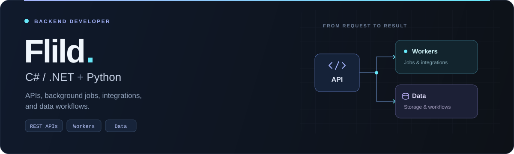

  

  
  
  
  

 

## Profile

I am a backend developer focused on **C#/.NET and Python**. I build APIs, integrations, background workers, and data services for products that need clear boundaries, reliable execution, and useful observability.

<table>
  <tr>
    <td width="33%" valign="top"><strong>BACKEND SYSTEMS</strong> APIs, services, workers, and integrations designed around clear ownership.</td>
    <td width="33%" valign="top"><strong>DATA WORKFLOWS</strong> Persistence, processing, forecasting, and the contracts between them.</td>
    <td width="33%" valign="top"><strong>ENGINEERING MINDSET</strong> Readable code, observable behavior, and repeatable delivery.</td>
  </tr>
</table>

  <b>FOCUS</b> &nbsp; Backend architecture · API design · Async processing · Data pipelines · Automation

## Capabilities

<table>
  <tr>
    <td width="25%"><strong>CORE</strong></td>
    <td><code>C#</code> · <code>.NET</code> · <code>ASP.NET Core</code> · <code>Python</code> · <code>FastAPI</code></td>
  </tr>
  <tr>
    <td><strong>DATA</strong></td>
    <td><code>PostgreSQL</code> · <code>SQL Server</code> · <code>Entity Framework Core</code> · Data preparation</td>
  </tr>
  <tr>
    <td><strong>SYSTEMS</strong></td>
    <td><code>RabbitMQ</code> · <code>Celery</code> · Background workers · Service integrations</td>
  </tr>
  <tr>
    <td><strong>DELIVERY</strong></td>
    <td><code>Docker</code> · <code>Git</code> · REST APIs · CI workflows · Automation</td>
  </tr>
</table>

## Selected work

Selected work that shows how I approach backend systems, data, and stateful software.

<table>
  <tr>
    <td width="50%" valign="top">
      <h3><a href="https://github.com/flild/CosmoStreetFoodEShop">01 / CosmoStreetFoodEShop</a></h3>
      
Multi-service e-commerce platform with separate product, cart, coupon, email, and authentication domains.

      
<b>DEMONSTRATES</b> · Service boundaries · API design · Persistence · Integration

      
<code>C#</code> <code>.NET</code> <code>EF Core</code> <code>PostgreSQL</code> <code>SQL Server</code>

    </td>
    <td width="50%" valign="top">
      <h3><a href="https://github.com/flild/AIMarketPrediction">02 / AIMarketPrediction</a></h3>
      
Time-series forecasting experiment using an LSTM model to estimate natural-gas futures prices from historical data.

      
<b>DEMONSTRATES</b> · Data preparation · Model experimentation · Forecast visualization

      
<code>Python</code> <code>LSTM</code> <code>Jupyter</code> <code>Time series</code>

    </td>
  </tr>
  <tr>
    <td colspan="2" valign="top">
      <h3><a href="https://github.com/flild/Minecraft-Curse-Cycle">03 / Minecraft-Curse-Cycle</a></h3>
      
Fabric mod that introduces gameplay challenges during survival runs, with multiplayer synchronization and an in-game interface.

      
<b>DEMONSTRATES</b> · Server-authoritative state · Multiplayer behavior · Event-driven features

      
<code>Java</code> <code>Fabric</code> <code>State management</code>

    </td>
  </tr>
</table>

## Engineering lens

<table>
  <tr>
    <td width="33%" valign="top"><strong>01 / BOUNDARIES FIRST</strong> Design ownership and change points before implementation gets expensive.</td>
    <td width="33%" valign="top"><strong>02 / DATA AS A CONTRACT</strong> Make inputs, outputs, persistence, and failure paths explicit.</td>
    <td width="33%" valign="top"><strong>03 / OPERATIONS BY DESIGN</strong> Prefer observable behavior and repeatable workflows over heroics.</td>
  </tr>
</table>

## GitHub activity

  
  

 

  <h2>Let’s build something useful.</h2>
  
Open to interesting backend problems, thoughtful collaborations, and systems that are worth improving.

  <a href="https://github.com/flild">View GitHub profile</a>

  Backend systems · data workflows · continuous improvement

